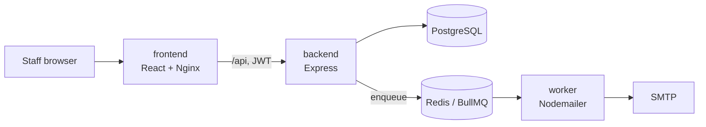

# CommuCloud

**English** · [中文](#中文)

A web app that runs condominium owners' meetings (區分所有權人會議) end to end: resident check-in, proposal voting, and live quorum tracking by both headcount and floor area.

Taiwan's condominium law requires a meeting to reach two quorums at once — a number of owners *and* a share of total floor area. Committees usually track this on paper during the meeting. CommuCloud records each check-in and vote as it happens and shows whether both thresholds are met.

## Features

- **Check-in** — batch-generated QR codes per resident, scanned at the door with a phone or laptop, plus manual check-in.
- **Voting** — printable QR ballots per resident and proposal; scanning a ballot records the vote and the supervising staff member.
- **Live quorum** — attendance and votes counted against each meeting's headcount and floor-area thresholds.
- **Multi-tenant and role-based** — every record belongs to one community; `admin`, `manager` and `meeting_assistant` roles are enforced in both the API and the UI.
- **Email notices** — meeting notices queued in BullMQ with retries and sent by a separate worker.

## Architecture



| Directory | Contents |
| --- | --- |
| [`backend/`](backend) | Express 5 API, Prisma schema and migrations, integration tests |
| [`frontend/`](frontend) | React 18 + Vite admin console with QR scanning |
| [`infra/`](infra) | Docker Compose stacks for development and production, email worker |

## Quick start

```bash
cd infra
cp .env.dev.example .env.dev      # fill in database password, JWT secret and SMTP credentials
docker network create dev-net     # once
./deploy-dev.sh
docker compose -p community-dev exec backend pnpm migrate
docker compose -p community-dev exec backend pnpm seed     # optional demo data
```

Frontend: http://localhost:5173 · API: http://localhost:3000

## Tech stack

Node.js · Express 5 · PostgreSQL 16 · Prisma · Redis · BullMQ · JWT · React 18 · Vite · Docker · Nginx · Jest · Supertest

## Tests

```bash
cd backend && pnpm test
```

Integration tests run against a real PostgreSQL and Redis and cover authentication, RBAC, tenant isolation, sub-account management, check-in, voting and quorum calculation, including the same QR code being scanned on several devices at once.

---

## 中文

社區區分所有權人會議的管理系統，涵蓋住戶報到、提案表決，以及依出席戶數與坪數比例即時計算的法定門檻。

依《公寓大廈管理條例》，區權會須同時達到人數與區分所有權比例兩項門檻，多數管委會在會議現場仍以紙本統計。CommuCloud 於報到與投票當下即寫入紀錄，並即時顯示兩項門檻是否達成。

### 功能

- **報到** — 批次產生每戶 QR Code，於入口以手機或筆電掃描，另支援手動報到。
- **表決** — 為每戶、每個提案產生可列印的 QR 選票，掃描後記錄投票結果與監票人員。
- **即時門檻** — 依每場會議設定的出席戶數與坪數門檻，即時統計出席與表決結果。
- **多社區與角色權限** — 所有資料皆隸屬單一社區，`admin`、`manager`、`meeting_assistant` 角色權限於 API 與介面同時生效。
- **Email 通知** — 會議通知排入 BullMQ，具重試機制，由獨立 worker 寄送。

### 目錄

| 目錄 | 內容 |
| --- | --- |
| [`backend/`](backend) | Express 5 API、Prisma schema 與 migrations、整合測試 |
| [`frontend/`](frontend) | React 18 + Vite 管理後台，含 QR 掃描 |
| [`infra/`](infra) | 開發與正式環境的 Docker Compose 設定、寄信 worker |

### 快速啟動

```bash
cd infra
cp .env.dev.example .env.dev      # 填入資料庫密碼、JWT secret 與 SMTP 帳號
docker network create dev-net     # 只需執行一次
./deploy-dev.sh
docker compose -p community-dev exec backend pnpm migrate
docker compose -p community-dev exec backend pnpm seed     # 選用：示範資料
```

前端：http://localhost:5173 · API：http://localhost:3000

### 技術

Node.js · Express 5 · PostgreSQL 16 · Prisma · Redis · BullMQ · JWT · React 18 · Vite · Docker · Nginx · Jest · Supertest

### 測試

```bash
cd backend && pnpm test
```

整合測試連接真實的 PostgreSQL 與 Redis，涵蓋登入註冊、角色權限、多社區隔離、子帳號管理、報到、表決與門檻計算，包含同一張 QR Code 同時在多台裝置被掃描的情況。
