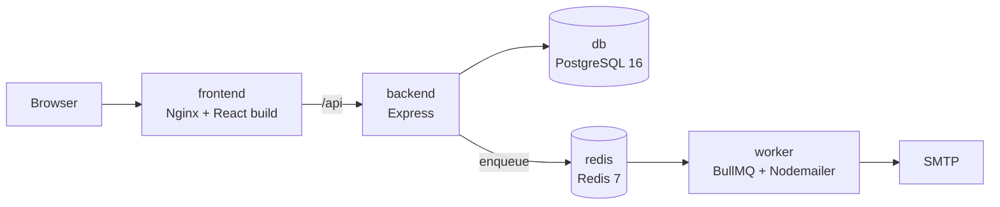

# CommuCloud — Infrastructure

Docker Compose stacks and the email worker for **CommuCloud**, a web app that runs condominium owners' meetings: resident check-in, proposal voting, and live quorum tracking.

| Repository | Role |
| --- | --- |
| [community-app-backend](https://github.com/jeje898281/community-app-backend) | Express API, PostgreSQL schema, job producer |
| [community-app-frontend](https://github.com/jeje898281/community-app-frontend) | React admin console and QR scanning pages |
| **community-app-infra** (this repo) | Docker Compose stacks and the email worker |

## Services



| Service | Image / build | Notes |
| --- | --- | --- |
| `db` | `postgres:16` | Health-checked with `pg_isready`; data in a named volume |
| `redis` | `redis:7-alpine` | Queue backend and cache; health-checked |
| `worker` | `./worker` | Consumes the `notification` queue and sends email through SMTP |
| `backend` | `../backend` | Starts after `db` and `redis` report healthy |
| `frontend` | `../frontend` | Vite dev server in development, Nginx in production |

`service-net` is an internal network with no outside access, and PostgreSQL is published only on `127.0.0.1`. In production the frontend and backend also join a shared `edge-net` network behind a reverse proxy that terminates TLS.

## Directory layout

The compose files build the backend and frontend from sibling directories:

```
community-app/
  backend/    ← community-app-backend
  frontend/   ← community-app-frontend
  infra/      ← this repo
```

```bash
mkdir community-app && cd community-app
git clone https://github.com/jeje898281/community-app-backend.git backend
git clone https://github.com/jeje898281/community-app-frontend.git frontend
git clone https://github.com/jeje898281/community-app-infra.git infra
```

## Local development

```bash
cd infra
cp .env.dev.example .env.dev      # fill in database password, JWT secret and SMTP credentials
docker network create dev-net     # once
./deploy-dev.sh
```

- Frontend: http://localhost:5173
- API: http://localhost:3000 (health check at `/api/health`)

Then run the database migrations and, optionally, the demo seed inside the backend container:

```bash
docker compose -p community-dev exec backend pnpm migrate
docker compose -p community-dev exec backend pnpm seed
```

Source directories are mounted into the containers, so code changes reload without rebuilding.

## Production

```bash
cp .env.dev.example .env.prod     # use production values
./deploy-prod.sh
```

`docker-compose.prod.yml` builds the production images (multi-stage backend image with a health check, Nginx frontend), keeps PostgreSQL bound to `127.0.0.1`, and attaches the frontend and backend to `edge-net` for the reverse proxy.
