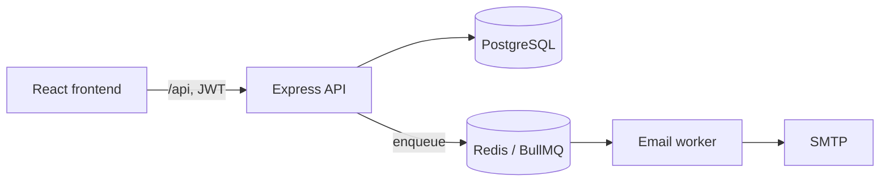

# CommuCloud — Backend

REST API for **CommuCloud**, a web app that runs condominium owners' meetings (區分所有權人會議) end to end: resident check-in, proposal voting, and live quorum tracking by both headcount and floor area.

Taiwan's condominium law requires a meeting to reach two quorums at once — a number of owners *and* a share of total floor area. Committees usually track this on paper during the meeting. CommuCloud records each check-in and vote as it happens and reports whether both thresholds are met.

| Repository | Role |
| --- | --- |
| **community-app-backend** (this repo) | Express API, PostgreSQL schema, job producer |
| [community-app-frontend](https://github.com/jeje898281/community-app-frontend) | React admin console and QR scanning pages |
| [community-app-infra](https://github.com/jeje898281/community-app-infra) | Docker Compose stacks and the email worker |

## Features

- **Multi-tenant communities** — every admin, resident, meeting and vote belongs to one community; services check ownership before every read and write.
- **Role-based access control** — `admin`, `manager` and `meeting_assistant` roles, with self-modification and last-admin protection.
- **Check-in** — per-resident QR codes generated in batch, plus manual check-in; each record stores who handled it.
- **Quorum summary** — attendance counted against both the resident threshold and the floor-area (sqm) percentage threshold of each meeting.
- **Proposal voting** — printable QR ballots per resident and proposal; scanning a ballot records the vote and the supervising staff member.
- **Resident import** — bulk create residents with unit code, floor area and email.
- **Email notifications** — meeting notices are queued in BullMQ (Redis) with retries and exponential backoff, and sent by a separate worker.
- **Hardening** — Helmet headers, CORS allow-list, rate-limited auth routes, bcrypt password hashing, JWT sessions, soft-deactivated accounts.

## Tech stack

Node.js · Express 5 · PostgreSQL 16 · Prisma · Redis · BullMQ · JWT · Jest · Supertest · Docker

## Architecture



The code follows a routes → controllers → services → models layout. Domain errors extend a shared `BaseError` and are mapped to HTTP responses with stable error codes (for example `USERNAME_TAKEN` or `TARGET_USER_NOT_IN_COMMUNITY`) by one error handler.

```
src/
  routes/        HTTP routing and role guards
  controllers/   request parsing and responses
  services/      business rules (quorum, voting, tenancy checks)
  models/        Prisma data access
  middleware/    auth, RBAC, rate limiting, error handling
  queue/         BullMQ producer
  errors/        typed domain errors
prisma/          schema, migrations, demo seed data
tests/           integration tests
```

## Data model

`Community` → `AdminUser`, `Resident`, `Meeting` → `MeetingAttendanceLog`, `Proposal` → `VoteLog`.
See [`prisma/schema.prisma`](prisma/schema.prisma).

## Getting started

The full stack (PostgreSQL, Redis, worker, backend, frontend) is started from [community-app-infra](https://github.com/jeje898281/community-app-infra). To run the API on its own:

```bash
pnpm install
cp .env.example .env        # fill in DATABASE_URL, JWT_SECRET, ...
pnpm migrate                # prisma migrate dev
pnpm seed                   # optional: demo community with meetings, proposals and votes
pnpm dev                    # http://localhost:3000
```

Health check: `GET /api/health`.

### Environment variables

| Name | Purpose |
| --- | --- |
| `DATABASE_URL` | PostgreSQL connection string |
| `REDIS_HOST` / `REDIS_PORT` / `REDIS_PASSWORD` / `REDIS_CLUSTER` | Redis for the queue and cache |
| `JWT_SECRET` | Token signing key |
| `CORS_ORIGIN` | Comma-separated list of allowed origins |
| `APP_NAMESPACE` | Prefix for Redis cache keys |
| `DEMO_LOGIN_ENABLED`, `DEMO_USERNAME` | Optional read-only demo login |

## Tests

Integration tests call the API through Supertest against a real PostgreSQL and Redis and cover authentication, RBAC, tenant isolation and sub-account management.

```bash
pnpm test
```

## API overview

| Area | Endpoints |
| --- | --- |
| Auth | `POST /api/auth/register`, `POST /api/auth/login` |
| Meetings | `GET/POST/PATCH /api/meeting`, `POST /api/meeting/checkin`, `GET /api/meeting/summary/:id`, `GET /api/meeting/records/:id`, `POST /api/meeting/generate-qr-codes` |
| Proposals | `GET /api/proposal/meeting/:id`, `POST/PATCH/DELETE /api/proposal`, `GET /api/proposal/meeting/:id/ballots`, `POST /api/proposal/vote` |
| Residents | `GET/POST/PATCH/DELETE /api/resident`, `POST /api/resident/bulk` |
| Admin users | `GET/POST/PATCH/DELETE /api/admin/users` |
| Notifications | `GET /api/meetings/:id/notify/preview`, `POST /api/meetings/:id/notify` |
| Community & profile | `GET/PUT /api/community`, `GET/PUT /api/profile`, `PUT /api/profile/password` |
