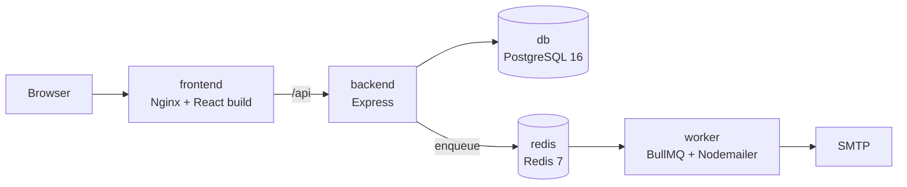

# CommuCloud — Infrastructure

**English** · [中文](#中文)

Docker Compose stacks and the email worker for **CommuCloud**, a web app that runs condominium owners' meetings: resident check-in, proposal voting, and live quorum tracking.

| Repository | Role |
| --- | --- |
| [community-app-backend](https://github.com/jeje898281/community-app-backend) | Express API, PostgreSQL schema, job producer |
| [community-app-frontend](https://github.com/jeje898281/community-app-frontend) | React admin console and QR scanning pages |
| **community-app-infra** (this repo) | Docker Compose stacks and the email worker |

## Services



| Service | Image / build | Notes |
| --- | --- | --- |
| `db` | `postgres:16` | Health-checked with `pg_isready`; data in a named volume |
| `redis` | `redis:7-alpine` | Queue backend and cache; health-checked |
| `worker` | `./worker` | Consumes the `notification` queue and sends email through SMTP |
| `backend` | `../backend` | Starts after `db` and `redis` report healthy |
| `frontend` | `../frontend` | Vite dev server in development, Nginx in production |

`service-net` is an internal network with no outside access, and PostgreSQL is published only on `127.0.0.1`. In production the frontend and backend also join a shared `edge-net` network behind a reverse proxy that terminates TLS.

## Directory layout

The compose files build the backend and frontend from sibling directories:

```
community-app/
  backend/    ← community-app-backend
  frontend/   ← community-app-frontend
  infra/      ← this repo
```

```bash
mkdir community-app && cd community-app
git clone https://github.com/jeje898281/community-app-backend.git backend
git clone https://github.com/jeje898281/community-app-frontend.git frontend
git clone https://github.com/jeje898281/community-app-infra.git infra
```

## Local development

```bash
cd infra
cp .env.dev.example .env.dev      # fill in database password, JWT secret and SMTP credentials
docker network create dev-net     # once
./deploy-dev.sh
```

- Frontend: http://localhost:5173
- API: http://localhost:3000 (health check at `/api/health`)

Then run the database migrations and, optionally, the demo seed inside the backend container:

```bash
docker compose -p community-dev exec backend pnpm migrate
docker compose -p community-dev exec backend pnpm seed
```

Source directories are mounted into the containers, so code changes reload without rebuilding.

## Production

```bash
cp .env.dev.example .env.prod     # use production values
./deploy-prod.sh
```

`docker-compose.prod.yml` builds the production images (multi-stage backend image with a health check, Nginx frontend), keeps PostgreSQL bound to `127.0.0.1`, and attaches the frontend and backend to `edge-net` for the reverse proxy.

---

## 中文

**CommuCloud** 的 Docker Compose 部署設定與寄信 worker。CommuCloud 是社區區分所有權人會議的管理系統，涵蓋住戶報到、提案表決與即時門檻統計。

| Repository | 角色 |
| --- | --- |
| [community-app-backend](https://github.com/jeje898281/community-app-backend) | Express API、PostgreSQL 資料結構、工作佇列 producer |
| [community-app-frontend](https://github.com/jeje898281/community-app-frontend) | React 管理後台與 QR 掃描頁面 |
| **community-app-infra**（本 repo） | Docker Compose 部署設定與寄信 worker |

### 服務

| 服務 | 映像檔／建置來源 | 說明 |
| --- | --- | --- |
| `db` | `postgres:16` | 以 `pg_isready` 健康檢查，資料存於 named volume |
| `redis` | `redis:7-alpine` | 工作佇列與快取，具健康檢查 |
| `worker` | `./worker` | 消費 `notification` 佇列，透過 SMTP 寄信 |
| `backend` | `../backend` | 待 `db` 與 `redis` 健康後才啟動 |
| `frontend` | `../frontend` | 開發環境為 Vite dev server，正式環境為 Nginx |

`service-net` 為不對外的內部網路，PostgreSQL 僅綁定 `127.0.0.1`。正式環境中前端與後端另加入共用的 `edge-net`，由反向代理處理 TLS。

### 目錄結構

compose 檔從同層目錄建置前後端：

```bash
mkdir community-app && cd community-app
git clone https://github.com/jeje898281/community-app-backend.git backend
git clone https://github.com/jeje898281/community-app-frontend.git frontend
git clone https://github.com/jeje898281/community-app-infra.git infra
```

### 本機開發

```bash
cd infra
cp .env.dev.example .env.dev      # 填入資料庫密碼、JWT secret 與 SMTP 帳號
docker network create dev-net     # 只需執行一次
./deploy-dev.sh
docker compose -p community-dev exec backend pnpm migrate
docker compose -p community-dev exec backend pnpm seed     # 選用：示範資料
```

前端位於 http://localhost:5173，API 位於 http://localhost:3000。原始碼以 volume 掛載進容器，修改後不需重新建置。

### 正式環境

```bash
cp .env.dev.example .env.prod     # 改為正式環境的設定值
./deploy-prod.sh
```

`docker-compose.prod.yml` 建置正式映像檔（含健康檢查的多階段後端映像檔、Nginx 前端），PostgreSQL 僅綁定 `127.0.0.1`，前後端加入 `edge-net` 供反向代理使用。
