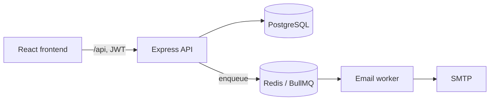

# CommuCloud — Backend

**English** · [中文](#中文)

REST API for **CommuCloud**, a web app that runs condominium owners' meetings (區分所有權人會議) end to end: resident check-in, proposal voting, and live quorum tracking by both headcount and floor area.

Taiwan's condominium law requires a meeting to reach two quorums at once — a number of owners *and* a share of total floor area. Committees usually track this on paper during the meeting. CommuCloud records each check-in and vote as it happens and reports whether both thresholds are met.

Part of the [CommuCloud](../README.md) monorepo: [`backend/`](../backend) · [`frontend/`](../frontend) · [`infra/`](../infra).

## Features

- **Multi-tenant communities** — every admin, resident, meeting and vote belongs to one community; services check ownership before every read and write.
- **Role-based access control** — `admin`, `manager` and `meeting_assistant` roles, with self-modification and last-admin protection.
- **Check-in** — per-resident QR codes generated in batch, plus manual check-in; each record stores who handled it.
- **Quorum summary** — attendance counted against both the resident threshold and the floor-area (sqm) percentage threshold of each meeting.
- **Proposal voting** — printable QR ballots per resident and proposal; scanning a ballot records the vote and the supervising staff member.
- **Resident import** — bulk create residents with unit code, floor area and email.
- **Email notifications** — meeting notices are queued in BullMQ (Redis) with retries and exponential backoff, and sent by a separate worker.
- **Hardening** — Helmet headers, CORS allow-list, rate-limited auth routes, bcrypt password hashing, JWT sessions, soft-deactivated accounts.

## Tech stack

Node.js · Express 5 · PostgreSQL 16 · Prisma · Redis · BullMQ · JWT · Jest · Supertest · Docker

## Architecture



The code follows a routes → controllers → services → models layout. Domain errors extend a shared `BaseError` and are mapped to HTTP responses with stable error codes (for example `USERNAME_TAKEN` or `TARGET_USER_NOT_IN_COMMUNITY`) by one error handler.

```
src/
  routes/        HTTP routing and role guards
  controllers/   request parsing and responses
  services/      business rules (quorum, voting, tenancy checks)
  models/        Prisma data access
  middleware/    auth, RBAC, rate limiting, error handling
  queue/         BullMQ producer
  errors/        typed domain errors
prisma/          schema, migrations, demo seed data
tests/           integration tests
```

## Data model

`Community` → `AdminUser`, `Resident`, `Meeting` → `MeetingAttendanceLog`, `Proposal` → `VoteLog`.
See [`prisma/schema.prisma`](prisma/schema.prisma).

## Getting started

The full stack (PostgreSQL, Redis, worker, backend, frontend) is started from [`infra/`](../infra). To run the API on its own:

```bash
pnpm install
cp .env.example .env        # fill in DATABASE_URL, JWT_SECRET, ...
pnpm migrate                # prisma migrate dev
pnpm seed                   # optional: demo community with meetings, proposals and votes
pnpm dev                    # http://localhost:3000
```

Health check: `GET /api/health`.

### Environment variables

| Name | Purpose |
| --- | --- |
| `DATABASE_URL` | PostgreSQL connection string |
| `REDIS_HOST` / `REDIS_PORT` / `REDIS_PASSWORD` / `REDIS_CLUSTER` | Redis for the queue and cache |
| `JWT_SECRET` | Token signing key |
| `CORS_ORIGIN` | Comma-separated list of allowed origins |
| `APP_NAMESPACE` | Prefix for Redis cache keys |
| `DEMO_LOGIN_ENABLED`, `DEMO_USERNAME` | Optional read-only demo login |

## Tests

Integration tests call the API through Supertest against a real PostgreSQL and Redis and cover authentication, RBAC, tenant isolation, sub-account management, check-in, voting and quorum calculation, including the same QR code being scanned on several devices at once.

```bash
pnpm test
```

## API overview

| Area | Endpoints |
| --- | --- |
| Auth | `POST /api/auth/register`, `POST /api/auth/login` |
| Meetings | `GET/POST/PATCH /api/meeting`, `POST /api/meeting/checkin`, `GET /api/meeting/summary/:id`, `GET /api/meeting/records/:id`, `POST /api/meeting/generate-qr-codes` |
| Proposals | `GET /api/proposal/meeting/:id`, `POST/PATCH/DELETE /api/proposal`, `GET /api/proposal/meeting/:id/ballots`, `POST /api/proposal/vote` |
| Residents | `GET/POST/PATCH/DELETE /api/resident`, `POST /api/resident/bulk` |
| Admin users | `GET/POST/PATCH/DELETE /api/admin/users` |
| Notifications | `GET /api/meetings/:id/notify/preview`, `POST /api/meetings/:id/notify` |
| Community & profile | `GET/PUT /api/community`, `GET/PUT /api/profile`, `PUT /api/profile/password` |

---

## 中文

**CommuCloud** 的 REST API。CommuCloud 是社區區分所有權人會議的管理系統，涵蓋住戶報到、提案表決，以及依出席戶數與坪數比例即時計算的法定門檻。

依《公寓大廈管理條例》，區權會須同時達到人數與區分所有權比例兩項門檻，多數管委會在會議現場仍以紙本統計。CommuCloud 於報到與投票當下即寫入紀錄，並即時回報兩項門檻是否達成。

本目錄屬於 [CommuCloud](../README.md) monorepo：[`backend/`](../backend) · [`frontend/`](../frontend) · [`infra/`](../infra)。

### 功能

- **多社區隔離** — 管理員、住戶、會議與投票皆隸屬單一社區，所有讀寫前都會檢查歸屬。
- **角色權限** — `admin`、`manager`、`meeting_assistant` 三種角色，並防止自行修改權限與移除最後一位管理員。
- **報到** — 批次產生每戶 QR Code，另支援手動報到，每筆紀錄保留經手人員。
- **門檻統計** — 依每場會議設定的出席戶數與坪數百分比門檻，即時計算是否達成。
- **提案表決** — 為每戶、每個提案產生可列印的 QR 選票，掃描後記錄投票結果與監票人員。
- **住戶匯入** — 批次建立住戶的戶號、坪數與 Email。
- **Email 通知** — 會議通知排入 BullMQ（Redis），具重試與指數退避，由獨立 worker 寄送。
- **安全設定** — Helmet 標頭、CORS 白名單、登入路由限流、bcrypt 密碼雜湊、JWT 驗證、帳號軟停用。

### 技術

Node.js · Express 5 · PostgreSQL 16 · Prisma · Redis · BullMQ · JWT · Jest · Supertest · Docker

### 架構

程式採 routes → controllers → services → models 分層。領域錯誤皆繼承共用的 `BaseError`，由統一的錯誤處理器轉為 HTTP 回應與固定的錯誤代碼（例如 `USERNAME_TAKEN`、`TARGET_USER_NOT_IN_COMMUNITY`）。架構圖與目錄結構請見上方英文段落。

### 本機啟動

完整環境（PostgreSQL、Redis、worker、後端、前端）由 [`infra/`](../infra) 啟動。單獨執行 API：

```bash
pnpm install
cp .env.example .env        # 填入 DATABASE_URL、JWT_SECRET 等設定
pnpm migrate                # prisma migrate dev
pnpm seed                   # 選用：建立含會議、提案與投票的示範社區
pnpm dev                    # http://localhost:3000
```

健康檢查：`GET /api/health`。環境變數說明見上方英文段落的表格。

### 測試

整合測試透過 Supertest 呼叫 API，連接真實的 PostgreSQL 與 Redis，涵蓋登入註冊、角色權限、多社區隔離、子帳號管理、報到、表決與門檻計算，包含同一張 QR Code 同時在多台裝置被掃描的情況。

```bash
pnpm test
```
